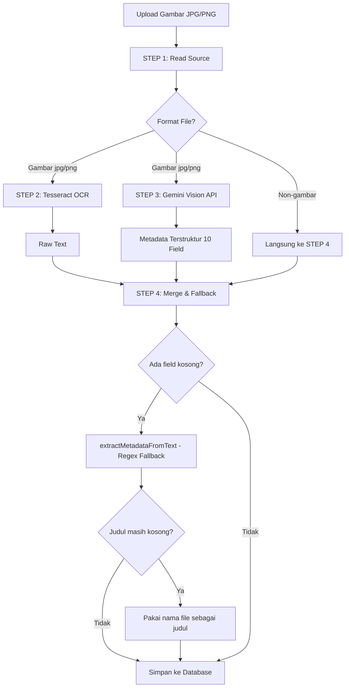
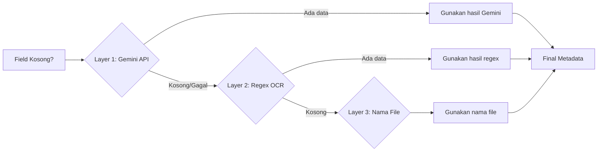
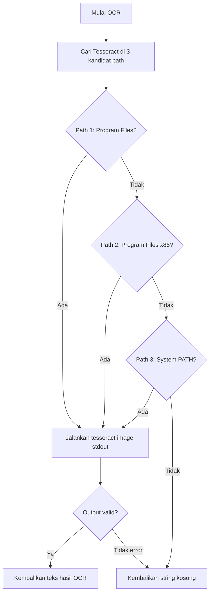
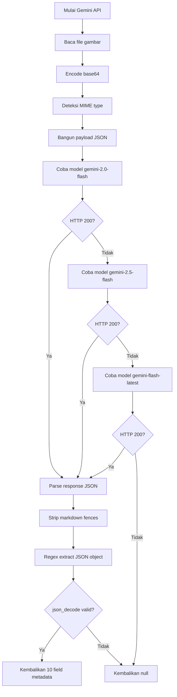
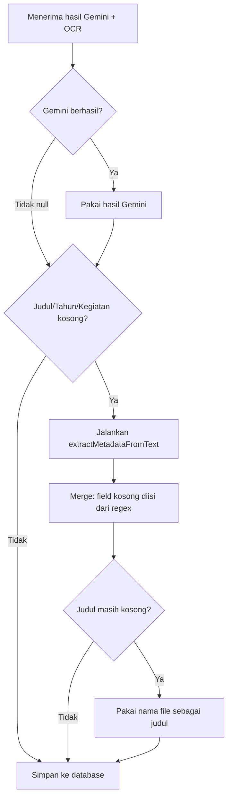

# Metodologi Pipeline OCR + Gemini AI

## Arsitektur Umum

Pipeline menggunakan pendekatan **dual-engine dengan fallback** — Tesseract OCR sebagai pembaca teks mentah, Gemini Vision API sebagai analisis semantik. Keduanya berjalan paralel pada dokumen yang sama, hasilnya digabungkan melalui mekanisme fallback bertingkat.

## Diagram Alur Pipeline



## Diagram Fallback 3 Layer



## STEP 2: Tesseract OCR

**File**: `helpers/ocr.php:13-40`

**Tujuan**: Ekstrak teks mentah dari gambar dokumen.



**Fallback regex** (`helpers/ocr.php:63-157`):

| Metadata | Metode Ekstraksi | Regex/Pattern |
|----------|-----------------|---------------|
| Tahun | Regex | `\b(19\d{2}\|20\d{2}\|2100)\b` |
| Jenis arsip | Keyword matching | laporan, proposal, surat, sertifikat, undangan, dll |
| Nomor dokumen | Regex | `Nomor\s*[:\-]?\s*([A-Za-z0-9\/.\-]+)` |
| Nama kegiatan | Regex | `(?:Nama Kegiatan\|Kegiatan\|Acara)\s*[:\-]?\s*(.+)` |
| Instansi | Regex | `(?:Instansi\|Dinas\|Kementerian\|...)\s*[:\-]?\s*(.+)` |

## STEP 3: Gemini Vision API

**File**: `helpers/gemini.php:14-117`

**Tujuan**: Analisis semantik — AI membaca isi dokumen dan mengekstrak metadata terstruktur.



**Payload yang dikirim ke API**:

```json
{
  "contents": [{
    "parts": [
      {
        "text": "Baca gambar dokumen arsip ini dan ekstrak semua metadata penting..."
      },
      {
        "inline_data": {
          "mime_type": "image/jpeg",
          "data": "base64..."
        }
      }
    ]
  }]
}
```

**10 Field output Gemini**:

| Field | Deskripsi | Tipe |
|-------|-----------|------|
| `raw_text` | Teks mentah seluruh dokumen | string |
| `judul` | Judul dokumen | string |
| `tahun` | Tahun pembuatan | int |
| `nomor_dokumen` | Nomor surat/dokumen | string |
| `jenis_arsip` | Surat, Laporan, Proposal, dll | string |
| `jenis_kegiatan` | Kegiatan, Seminar, Pelatihan, dll | string |
| `nama_kegiatan` | Nama kegiatan spesifik | string |
| `instansi` | Instansi/organisasi | string |
| `ringkasan` | Ringkasan isi dokumen | string |
| `data_terstruktur` | JSON objek data tambahan | object |

## STEP 4: Merge & Fallback

**File**: `process.php:41-83`



**Logika merge**:

```php
$judul    = $judul    ?: $metadata['judul'];
$tahun    = $tahun    ?: $metadata['tahun'];
$jenisKegiatan = $jenisKegiatan ?: $metadata['jenis_kegiatan'];
$jenisArsip    = $jenisArsip    ?: $metadata['jenis_arsip'];
$nomorDokumen  = $nomorDokumen  ?: $metadata['nomor_dokumen'];
$namaKegiatan  = $namaKegiatan  ?: $metadata['nama_kegiatan'];
$instansi      = $instansi      ?: $metadata['instansi'];
```

## Kelebihan Pendekatan

| Aspek | Detail |
|-------|--------|
| Redundansi | 3 layer fallback jarang gagal total |
| Paralelisme | OCR dan AI berjalan bersamaan |
| Model fleksibel | Model Gemini bisa diubah via constant `GEMINI_MODELS` |
| Graceful degradation | Non-gambar (PDF/DOC) tetap diproses tanpa OCR |
| Konsistensi output | Selalu 10 field JSON regardless of source |

## Keterbatasan

| Aspek | Detail |
|-------|--------|
| Tanpa confidence score | Hasil OCR/AI diterima tanpa skor keyakinan |
| Tesseract tanpa `--lang ind` | Default bahasa Inggris |
| Prompt statis | Tidak ada prompt per jenis dokumen |
| Tanpa caching | Dokumen sama diproses ulang jika di-reupload |
